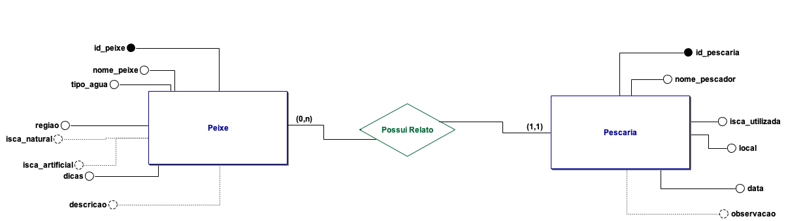
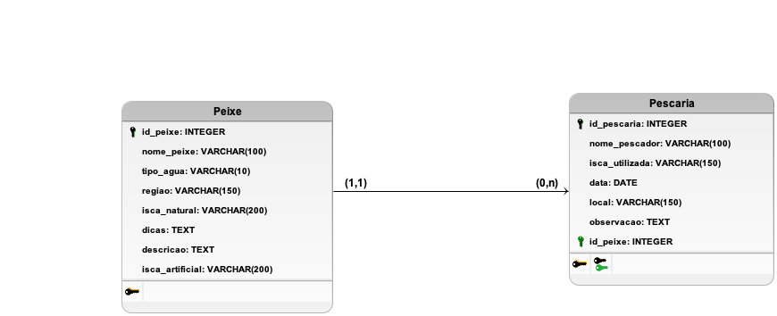

# Modelagem do Banco de Dados — MVP Pescaria

A modelagem foi desenvolvida no brModelo, utilizando duas entidades: Peixe e Pescaria. O banco de dados será implementado em SQLite.

## 1. Modelo Conceitual

O relacionamento **Possui Relato** estabelece que um peixe pode possuir zero ou vários relatos de pescaria (0,N), enquanto cada pescaria deve estar associada a exatamente um peixe (1,1).

## 2. Modelo Lógico

O modelo possui duas tabelas: `Peixe` e `Pescaria`, identificadas pelas chaves primárias `id_peixe` e `id_pescaria`, respectivamente.

A chave estrangeira `Pescaria.id_peixe` referencia `Peixe.id_peixe`, implementando o relacionamento 1:N.

## 3. Regras de Negócio

1. Um peixe pode existir sem nenhuma pescaria registrada ou com várias (0,N).
2. Cada pescaria deve estar associada a exatamente um peixe (1,1).
3. Não será permitido cadastrar uma pescaria associada a um peixe inexistente.
4. O atributo `descricao`, da tabela `Peixe`, é opcional.
5. Os atributos `isca_natural` e `isca_artificial`, da tabela `Peixe`, são opcionais, podendo ambos ficar sem preenchimento.
6. O atributo `observacao`, da tabela `Pescaria`, é opcional.
7. Os relatos não alteram as dicas oficiais do peixe.

## 4. Modelo Físico — SQLite

O banco será implementado em SQLite, utilizando chaves primárias e estrangeiras para garantir a integridade referencial.

O script de criação das tabelas está disponível em [schema.sql](../sql/schema.sql).
